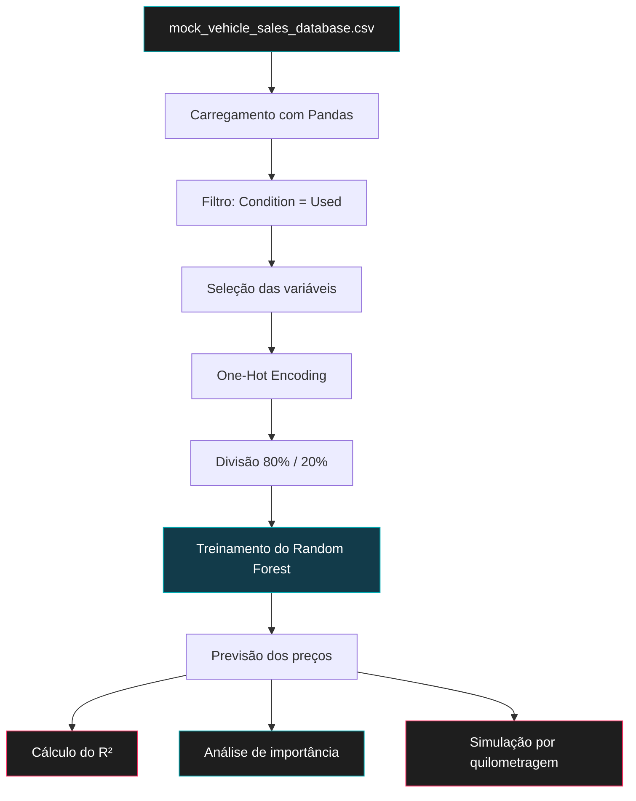

# 🚗 Precificação Dinâmica de Veículos Usados com Machine Learning

  

  
  
  
  
  
  

  <i>Aplicação de regressão para estimar preços de veículos usados a partir de características do veículo e dados históricos de vendas.</i>

---

## 📌 1. Visão geral

Neste projeto, desenvolvi um modelo de Machine Learning para estimar os preços de veículos usados com base em dados de ano de fabricação, quilometragem, marca e categoria.

Utilizei a base `mock_vehicle_sales_database.csv` como fonte de dados e selecionei os registros classificados como usados. A partir dessas observações, preparei as variáveis de entrada, treinei um modelo de regressão e avaliei seu desempenho em uma amostra separada para teste.

Além das previsões, construí um painel visual em Python para analisar a relação entre preços reais e estimados, a importância relativa das variáveis e o comportamento dos preços em uma simulação de quilometragem.

### 🎯 Objetivo

Estimar o valor de venda de veículos usados em reais (BRL), identificando relações entre suas características e os preços registrados na base de dados.

## 📊 2. Configuração e resultado do modelo

<table>
  <tr>
    <td align="center" width="50%">
      <h2>0,77</h2>
      <b>R² reportado</b>
       
      Coeficiente de determinação
    </td>
    <td align="center" width="50%">
      <h2>100</h2>
      <b>Árvores de decisão</b>
       
      Parâmetro n_estimators
    </td>
  </tr>
  <tr>
    <td align="center">
      <h3>80% / 20%</h3>
      <b>Divisão dos dados</b>
       
      Treinamento e teste
    </td>
    <td align="center">
      <h3>10</h3>
      <b>Profundidade máxima</b>
       
      Parâmetro max_depth
    </td>
  </tr>
</table>

O valor de \(R^2 = 0{,}77\) representa o resultado reportado na avaliação do modelo. Essa métrica indica a proporção da variabilidade dos preços explicada pelo modelo em relação a uma referência baseada na média dos valores observados.

Esse resultado não significa que 77% das previsões sejam exatamente corretas. A interpretação deve considerar a distribuição dos preços, os erros individuais e a representatividade dos dados utilizados.

---

## 🧠 3. Formulação do problema

O mercado de veículos usados apresenta relações não lineares entre as características dos automóveis e seus preços. A desvalorização não depende exclusivamente do tempo de uso: marca, categoria e quilometragem também estão associadas ao valor de mercado.

Para tratar esse problema, optei por um modelo de **regressão**, pois a variável que desejo estimar é numérica e contínua: o preço total do veículo em reais.

Diferentemente de um modelo de classificação, que prevê categorias, a regressão produz estimativas de valores monetários.

### Variáveis utilizadas

| Variável | Aplicação na modelagem |
|---|---|
| `Vehicle_Year` | Ano de fabricação do veículo |
| `Mileage_KM` | Quilometragem acumulada |
| `Vehicle_Make` | Marca do veículo |
| `Vehicle_Category` | Categoria do veículo |
| `Total_Price_BRL` | Variável-alvo: preço total em reais |

Antes do treinamento, filtrei a base para manter somente os registros cujo campo `Condition` estivesse classificado como `Used`. Essa decisão delimitou a análise aos veículos usados, em vez de misturar esses registros com veículos novos, cujos preços podem seguir outra lógica de formação.

---

## ⚙️ 4. Escolha do algoritmo: Random Forest Regressor

Escolhi o **Random Forest Regressor**, algoritmo de aprendizado supervisionado que combina múltiplas árvores de decisão para produzir uma previsão consolidada.

Durante o treinamento, as árvores aprendem relações entre as características dos veículos e os respectivos preços. Na etapa de previsão, o modelo agrega os resultados das árvores para estimar o valor de cada observação.

Essa abordagem permite representar relações não lineares sem exigir que a relação entre cada variável e o preço siga uma equação linear simples.

### Parâmetros utilizados

| Parâmetro | Valor | Função |
|---|---:|---|
| `n_estimators` | 100 | Quantidade de árvores do conjunto |
| `max_depth` | 10 | Profundidade máxima de cada árvore |
| `random_state` | 42 | Reprodutibilidade da inicialização aleatória |
| `test_size` | 0.20 | Proporção dos dados reservada para teste |

A combinação dessas configurações define a estrutura do modelo treinado. A limitação da profundidade restringe a complexidade individual das árvores, enquanto a agregação de múltiplas árvores pode reduzir a variabilidade das previsões.

O uso do Random Forest não elimina automaticamente o sobreajuste (*overfitting*), mas oferece uma abordagem adequada para investigar relações complexas em dados tabulares.

---

## 🔄 5. Preparação dos dados e treinamento

Organizei a implementação em etapas: carregamento da base, filtragem dos veículos usados, seleção das variáveis, codificação das categorias, divisão entre treinamento e teste e ajuste do modelo.

### Fluxo de processamento

### Codificação das variáveis categóricas

Utilizei o método `pd.get_dummies()` para transformar as variáveis `Vehicle_Make` e `Vehicle_Category` em colunas binárias.

Com o parâmetro `drop_first=True`, uma categoria de cada variável é omitida para evitar redundância na representação. Embora essa opção seja especialmente relevante em modelos lineares, mantive a configuração na implementação utilizada.

### Divisão entre treino e teste

Separei os dados com `train_test_split()`, reservando 80% para o treinamento e 20% para o teste, com `random_state=42`.

Dessa forma, avaliei as previsões em observações que não participaram diretamente do ajuste do modelo.

---

## 📈 6. Avaliação do desempenho

Utilizei o coeficiente de determinação, ou \(R^2\), para avaliar o desempenho preditivo do modelo.

A métrica compara a variação dos erros de previsão com a variabilidade dos preços observados. Em termos gerais, um resultado mais próximo de 1 indica maior capacidade explicativa em relação à referência baseada na média.

### Interpretação do resultado

O \(R^2 = 0{,}77\) reportado indica que o modelo explicou aproximadamente 77% da variabilidade dos preços na amostra avaliada.

A parcela restante não explicada pode estar associada a fatores ausentes das variáveis de entrada, como conservação física, histórico de acidentes, manutenção, localização e condições específicas de negociação.

Esses fatores são exemplos de variáveis que podem influenciar o mercado, mas não foram incluídos entre os preditores utilizados nesta implementação.

### Relevância financeira

A qualidade das estimativas tem implicações práticas para a precificação:

- **Preço acima do mercado:** pode reduzir a competitividade e prolongar o período de permanência do veículo no estoque.
- **Preço abaixo do mercado:** pode diminuir a margem obtida na venda.
- **Estimativas inconsistentes:** podem dificultar a comparação entre veículos com características semelhantes.

O \(R^2\) fornece uma visão geral do desempenho, mas não mede diretamente o valor monetário médio dos erros. Por isso, sua interpretação deve permanecer vinculada ao contexto dos dados e à finalidade da estimativa.

---

## 🔎 7. Importância das variáveis

Após o treinamento, extraí os valores de `feature_importances_` do Random Forest e organizei as oito variáveis com maior importância relativa.

O objetivo dessa etapa foi identificar quais atributos receberam maior peso na estrutura de decisão do modelo.

A importância calculada pelo Random Forest representa a contribuição relativa das variáveis para as divisões realizadas pelas árvores, segundo o critério interno do algoritmo. Ela não representa, necessariamente, um efeito causal sobre o preço.

Como utilizei One-Hot Encoding, as categorias de marca e de veículo aparecem individualmente na matriz de atributos. Assim, a análise considera tanto as variáveis numéricas originais quanto as colunas binárias criadas a partir das categorias.

A interpretação dos resultados deve considerar que variáveis correlacionadas podem compartilhar importância e que a relevância de um atributo para o modelo não equivale, por si só, à influência isolada desse atributo no mercado.

---

## 📉 8. Simulação preditiva: efeito da quilometragem

Além da avaliação realizada sobre os dados de teste, construí uma simulação para observar como as estimativas do modelo variam com a quilometragem.

Para essa análise, defini um veículo hipotético com ano de fabricação de 2018 e configurei a categoria SUV quando a respectiva coluna estivesse presente na matriz codificada.

Em seguida, gerei 50 valores de quilometragem, distribuídos entre 10.000 km e 150.000 km, e utilizei o modelo treinado para calcular os preços estimados em cada cenário.

### Configuração da simulação

| Parâmetro | Valor |
|---|---|
| Ano do veículo | 2018 |
| Categoria simulada | SUV, quando disponível na codificação |
| Quilometragem inicial | 10.000 km |
| Quilometragem final | 150.000 km |
| Quantidade de pontos | 50 |
| Saída | Preço estimado em BRL |

O gráfico resultante apresenta a relação entre a quilometragem simulada e o valor previsto pelo modelo, mantendo os demais atributos fixos.

Essa análise permite observar o comportamento das previsões dentro do cenário definido. Como se trata de uma simulação, a curva representa as estimativas produzidas pelo modelo, e não uma regra universal de desvalorização aplicável a todos os SUVs.

---

## 🎨 9. Painel visual e apresentação dos resultados

Para reunir as análises em uma única visualização, utilizei Matplotlib e Seaborn na construção de um painel em tema escuro.

Configurei o fundo em tons de preto e cinza, com elementos em ciano e rosa para diferenciar as informações. Organizei a figura em duas linhas e duas colunas, reservando a área inferior para a simulação de quilometragem.

O painel reúne três análises principais:

<b>Gráfico 1 — Preço real versus preço previsto</b>

O gráfico de dispersão compara os preços observados no conjunto de teste com as previsões do modelo. A linha tracejada representa a situação ideal, na qual o preço previsto coincide com o preço real.

Quanto mais próximos os pontos estiverem dessa linha, menor será a diferença entre os valores observados e estimados.

<b>Gráfico 2 — Importância relativa das variáveis</b>

O gráfico de barras apresenta as oito variáveis com maior importância segundo o Random Forest. Os nomes das colunas codificadas são convertidos em rótulos mais legíveis para facilitar a interpretação.

<b>Gráfico 3 — Simulação de depreciação por quilometragem</b>

O gráfico de linha apresenta as estimativas para o SUV hipotético de 2018 ao longo da faixa de quilometragem simulada. A área preenchida destaca visualmente a trajetória das previsões.

O painel foi desenvolvido com Matplotlib e Seaborn, enquanto Pandas e NumPy foram utilizados no tratamento e na organização dos dados. O treinamento e a avaliação do modelo foram realizados com scikit-learn.

---

## 🏁 10. Conclusão

Neste projeto, desenvolvi uma abordagem de regressão para estimar os preços de veículos usados a partir de dados de ano de fabricação, quilometragem, marca e categoria.

Escolhi o Random Forest Regressor pela capacidade de representar relações não lineares em dados tabulares. A implementação incluiu a seleção dos registros de veículos usados, a codificação das variáveis categóricas, a separação entre treinamento e teste e a avaliação por meio do coeficiente de determinação.

Também utilizei a importância das variáveis para examinar os atributos considerados pelo modelo e construí uma simulação para visualizar a variação dos preços estimados em diferentes níveis de quilometragem.

O resultado reportado de \(R^2 = 0{,}77\) resume o desempenho observado na avaliação realizada. Em conjunto, a modelagem e o painel visual documentam como transformei dados históricos de vendas em estimativas de preços e análises quantitativas de apoio à precificação.

---

  

  Python · Pandas · NumPy · Scikit-learn · Matplotlib · Seaborn

